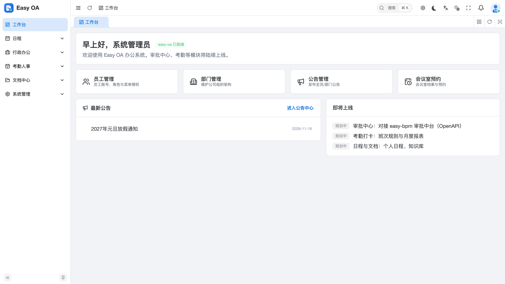
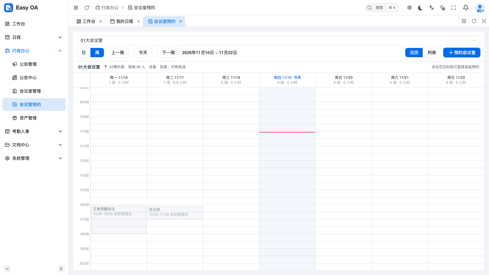
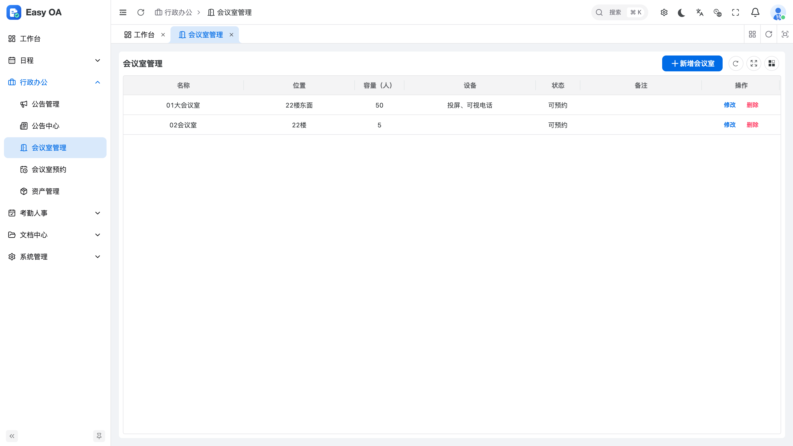
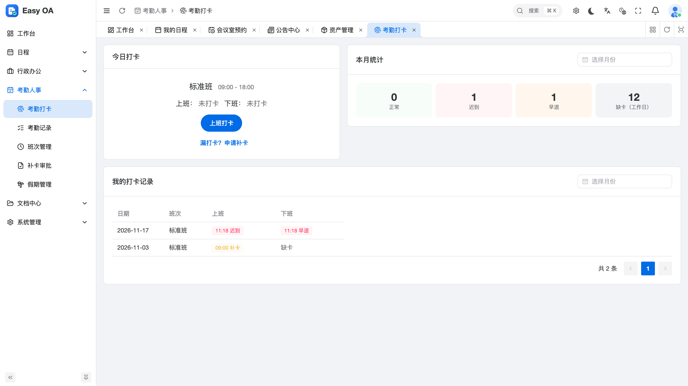
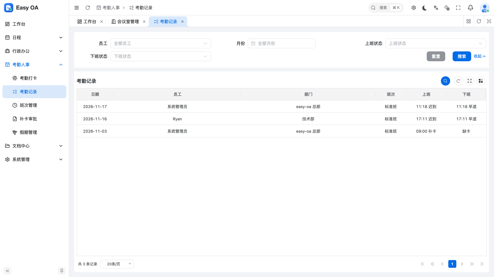
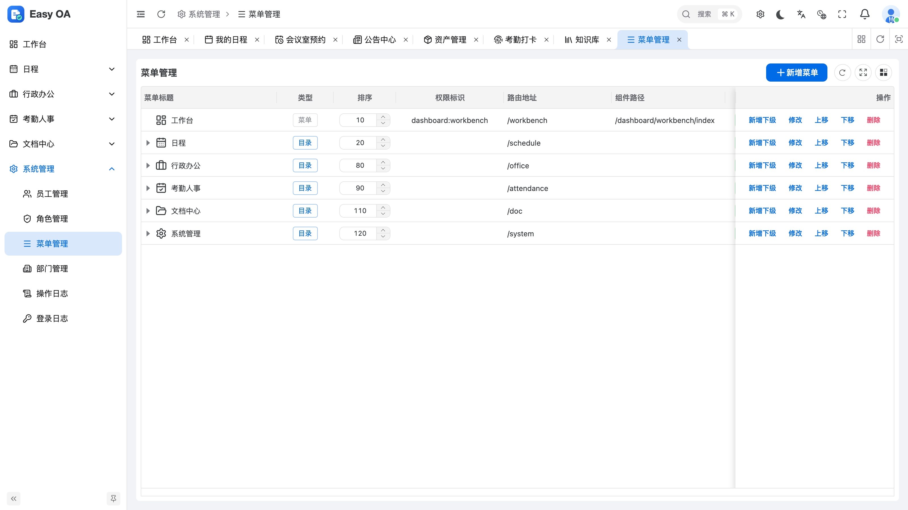

# easy-oa

轻量级 OA（办公自动化）系统，面向中小团队的一站式办公平台：**认证与组织架构、行政办公、考勤人事、日程与知识库**，审批流对接独立审批中台 easy-bpm（不自研流程引擎）。

- **后端**：Java 25 + Spring Boot 4.1.2 + MyBatis-Plus + MySQL，Spring Security + JWT 无状态认证，Redis 承载微信扫码登录的一次性凭证
- **前端**：Vue3 + Vben Admin 5（Element Plus），后端下发动态菜单 + 按钮级权限
- **端口**：后端接口服务 `8091`，前端 dev server `5778`；默认账号 **admin / admin123**
- **产线**：<https://oa.easykits.cn>（nginx 反代 `/oa` → 8091）

## 界面预览

**登录 & 工作台**

| 登录（账号密码 / 微信扫码） | 工作台 |
| :---: | :---: |
|  |  |
| 左侧品牌宣传区 + 右侧表单，支持微信扫码登录（未绑定引导绑定，绝不凭微信身份直接登录） | 问候语、快捷入口、最新公告与待上线模块提示 |

**行政办公**

| 会议室预约（日历时间轴） | 会议室档案 |
| :---: | :---: |
|  |  |
| 按会议室切换的 08:00–21:00 时间轴，并行会议自动分列，当前时间红线，点击空白格直接预约 | 容量、设备、状态维护，预约冲突检测 |

**考勤人事**

| 考勤打卡 | 考勤记录 |
| :---: | :---: |
|  |  |
| 今日打卡 + 本月统计（正常/迟到/早退/缺卡）+ 个人打卡流水（迟到早退标红） | 全员/按部门按月份筛选，补卡与异常状态一目了然 |

**系统管理**



> 菜单管理：树形结构维护（目录/菜单/按钮/外链/内嵌），支持排序值内联编辑与「上移 / 下移」整列重排，动态路由按角色下发。

## 功能总览

| 模块 | 功能要点 | 状态 |
| --- | --- | --- |
| 认证 | 账号密码登录（JWT）、防爆破锁定（5 次锁 15 分钟）、登录日志、操作日志 AOP | ✅ |
| 微信扫码登录 | unionid 主判据绑定（`sys_oauth_binding`）、Redis state/bindTicket 一次性消费防重放、未绑定走密码确认引导、mock 模式联调、禁止扫码自助注册 | ✅ |
| 系统管理 | 部门树 / 员工（含重置密码、启停用、分配角色）/ 角色授权 / 菜单（含排序）四级 RBAC | ✅ |
| 公告通知 | 发布 / 撤回 / 置顶 / 有效期，全员或按部门投放，已读回执与员工端公告中心 | ✅ |
| 会议室预约 | 会议室档案、时间段预约与冲突检测、日历时间轴视图与列表双视图、结束后禁止取消 | ✅ |
| 资产管理 | 固定资产/办公用品台账，领用 / 归还 / 转移流转记录，报废与丢失登记，自动编号 | ✅ |
| 考勤人事 | 班次与弹性打卡、每日打卡与迟到早退缺卡判定、个人月度统计、补卡申请与审批回写、假期类型与余额 | ✅ |
| 日程 | 个人日程/待办、重复规则（每天/每周/每月 + 截止日展开虚拟场次）、部门共享日程、月视图 | ✅ |
| 知识库 | 目录树 + 富文本编辑，ACL（部门 / 角色 / 指定人）沿目录链继承，标题与正文检索 | ✅ |
| 审批流 | 对接 easy-bpm OpenAPI（AppKey/AppSecret + 签名），OA 侧单据状态机兜底与回调幂等 | ⏳ 规划 |
| 报表与小程序 | 考勤月度汇总导出、移动端打卡/公告/审批 | ⏳ 规划 |

完整分期计划见 [docs/FEATURES.md](docs/FEATURES.md)，微信登录设计见 [docs/WECHAT_LOGIN.md](docs/WECHAT_LOGIN.md)。

## 技术栈

| 组件 | 版本 / 说明 |
| --- | --- |
| JDK | 25（`maven.compiler.release=25`） |
| Spring Boot | 4.1.2（单体，无微服务、无注册中心） |
| MyBatis-Plus | 3.5.18（`mybatis-plus-spring-boot4-starter`） |
| Spring Security | 7.x，无状态 JWT；登录失败计数在进程内存（重启即清零） |
| Redis | 微信扫码登录 state / bindTicket，`GETDEL` 原子消费防重放 |
| SpringDoc OpenAPI | 3.2.0，`/swagger-ui.html` |
| Vben Admin | 5.7.0 · web-ele（Vue 3 + Element Plus + Vite 8） |
| 数据库 | MySQL 8（开发）/ MySQL 5.7（腾讯云 CDB，生产） |
| 日志 | Logback（按天+按大小滚动，traceId 串联） |

## 模块

```
backend/easy-oa-admin   # 管理后台接口服务（打包固定 easy-oa-admin.jar）
web-admin/apps/web-ele  # 管理后台前端（vben web-ele，包名 @easy-oa/web-ele）
db/                     # easy_oa.sql 建库脚本 + migrations/ 幂等增量迁移（不入库，仅本地）
docs/                   # 功能清单、微信登录设计、界面截图
```

后端分层沿用 easy-mall 风格：顶层 `common / config / security / entity / mapper`，业务按域收在 `modules/<域>/{controller,service,dto,vo}`。

## 快速开始

```bash
# 1. 初始化数据库（库名写死在 application-dev.yml：127.0.0.1:3306/easy_oa）
mysql -uroot -p < db/easy_oa.sql
#    老库按序执行增量迁移
for f in db/migrations/*.sql; do mysql -uroot -p easy_oa < "$f"; done

# 2. 后端：配置本机密码（已被 .gitignore 忽略）
cp backend/easy-oa-admin/src/main/resources/application-local.yml.example \
   backend/easy-oa-admin/src/main/resources/application-local.yml
#    填入 spring.datasource.password（Redis 密码同文件）

# 3. 启动后端（Java 25）
export JAVA_HOME=$(/usr/libexec/java_home -v 25)
cd backend && mvn -pl easy-oa-admin spring-boot:run
# 接口文档 http://localhost:8091/swagger-ui.html

# 4. 启动前端
cd web-admin && pnpm -F @easy-oa/web-ele run dev
# 打开 http://localhost:5778，默认账号 admin / admin123

# 5. 打包（产物固定为 target/easy-oa-admin.jar）
cd backend && mvn -pl easy-oa-admin package -DskipTests
```

**配置约定**：数据库主机/端口/库名/用户名直接写死在 `application-dev.yml`（生产见 `application-prod.yml`），**不读 `MYSQL_*` 环境变量**——避免同时开发多个项目时残留的环境变量把库连错；密码、微信 AppSecret 等敏感项只放 `application-local.yml`（gitignore）或进程环境变量。

**微信扫码登录**：`oa.wechat.mock=true` 时跳过微信 API，以固定测试身份走完整流程（扫码 → 命中/未绑定 → 绑定引导 → 登录）；申请到开放平台网站应用 AppID/Secret 后置 `mock: false` 并配置回调域名即可切换真实登录。

## 目录与数据

- 迁移脚本：`db/migrations/YYYYMMDD_xxx.sql`，全部幂等；建库脚本 `db/easy_oa.sql` 仅新环境初始化用。
- 权限码分段：`system:` / `approval:` / `office:` / `attendance:` / `schedule:` / `doc:`，新增后端校验须同步 `PermissionCodes` 与菜单表。
- 关键表：`sys_user / sys_dept / sys_role / sys_menu / sys_user_role / sys_role_menu / sys_oauth_binding`、`sys_login_log / sys_oper_log`、`office_notice*`、`office_meeting_*`、`office_asset*`、`att_*`、`doc_folder / doc_document / doc_acl`、`sch_event`。

> 数据库脚本不随仓库分发，需要请联系作者。
